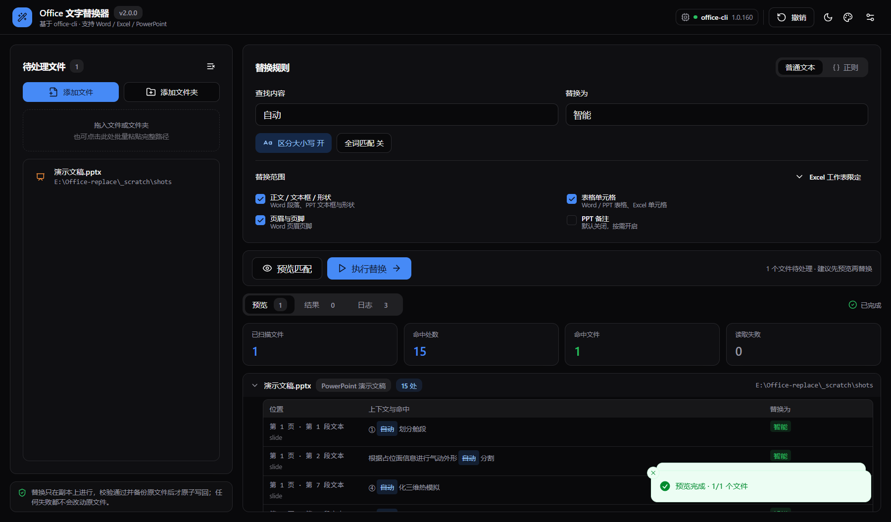
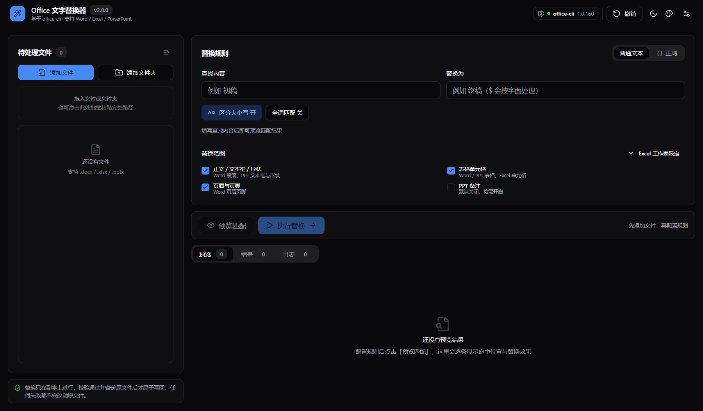
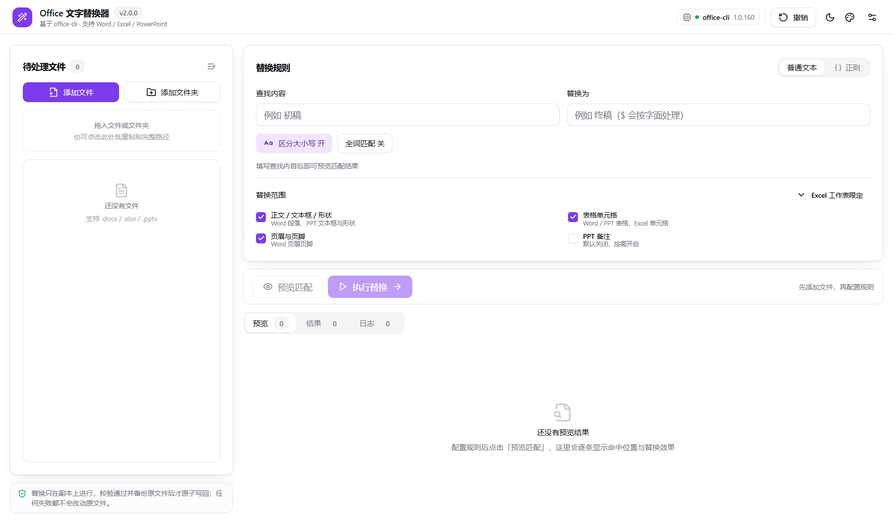
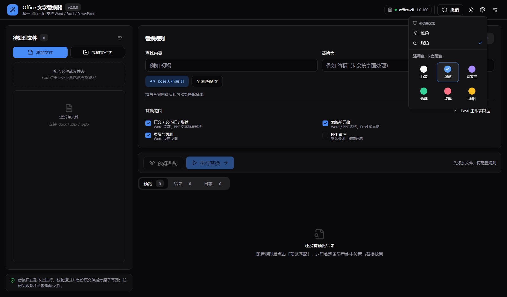
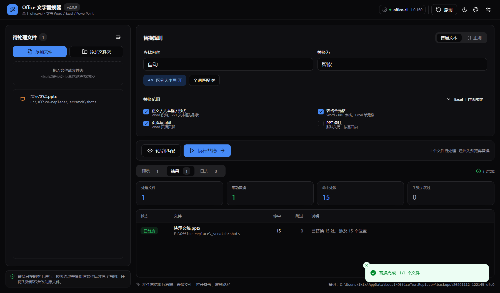

# Office 文字替换器

基于 [office-cli](https://officecli.ai/) 的桌面批量替换工具：支持 **Word (.docx)**、**Excel (.xlsx)**、**PowerPoint (.pptx)**，可一次处理单个文件或整个文件夹，先预览每一处命中，再执行替换。全程不依赖本机安装 Office。

**2.0 起界面由 shadcn/ui 重写**：React + Vite + Tailwind CSS + Radix UI 组件，QtWebEngine 承载，Python 本地服务提供能力桥接；自带 **12 套主题配色**（明暗 × 6 强调色）和**结果文件右键在文件管理器中定位**。



| 深色 · 湛蓝（默认） | 浅色 · 紫罗兰 |
| --- | --- |
|  |  |

---

## 1. 核心特性

| 能力 | 说明 |
| --- | --- |
| 三种格式 | docx / xlsx / pptx；旧版 .doc/.xls/.ppt 会提示先另存为新格式 |
| 文本覆盖 | Word：正文、表格、页眉、页脚、文本框；PPT：形状文本、表格、演讲者备注；Excel：所有工作表的文本与数字单元格 |
| 两种模式 | 普通文本（字面匹配）与正则表达式（.NET 语法，支持 `$1` / `${name}` 分组引用） |
| 匹配选项 | 区分大小写、全词匹配、替换范围（正文 / 表格 / 页眉页脚 / 备注）、Excel 工作表限定 |
| 预览 | 按文件分组列出「位置 + 上下文 + 替换结果」，命中词高亮；执行前即可判断风险 |
| 结果反馈 | 处理文件数、命中数量、跳过项（含原因）、失败原因、单个文件耗时、完整日志 |
| 主题配色 | 浅色 / 深色 × 石墨、湛蓝、紫罗兰、翡翠、玫瑰、琥珀；顶栏一键切换，配置跨会话保存 |
| 文件定位 | 结果行右键：在资源管理器中选中文件、打开所在文件夹、打开备份、复制路径 |
| 安全 | 临时副本替换 → 结构校验 → 自动备份 → 原子写回；失败时原文件零改动；可一键撤销 |
| 异常处理 | 无效正则、文件损坏、被 Office 占用、只读/无权限、无匹配项均有明确中文提示 |



---

## 2. 快速开始

### 绿色便携单文件版（推荐）

构建后取得 `dist/OfficeTextReplacer.exe`。只需复制这**一个 EXE** 到任意可写目录双击运行；内置 Python、QtWebEngine、前端静态资源和 office-cli 1.0.160，目标机器无需安装 Python、Node、Office 或 office-cli。程序不主动写注册表；首次运行在 **EXE 同级**创建 `OfficeTextReplacer-data/`，保存配置、壁纸和备份。单文件启动时 PyInstaller/Qt 会临时解压运行资源到系统临时目录，退出后由引导程序清理。

> 请放在**可写目录**；若放在 Program Files 等只读目录，同级配置目录可能创建失败。备份可能含原始文档敏感内容，移动/分享时不要连同 `OfficeTextReplacer-data/` 一起发送。尚未做干净机器全功能回归，GitHub 源码仓库不会提交构建产物 EXE。

从源码重新构建（Windows 开发机）：

```bash
python -m pip install -r requirements.txt -r requirements-build.txt
npm --prefix web ci
npm --prefix web run build
python -m PyInstaller --noconfirm --clean OfficeTextReplacer.spec
```

构建机必须可定位 `officecli.exe`（或设置 `OFFICECLI_BIN` 指向其绝对路径）。最终运行时不依赖构建机路径。

### 源码运行环境要求

- Windows 10/11，Python 3.10+
- [office-cli](https://github.com/iOfficeAI/OfficeCLI)（替换引擎，单文件二进制，无需安装 Office）
- **运行期不需要 Node.js**：`web/dist/` 已随项目交付，是构建好的静态资源

```bash
# 1) 安装 Python 依赖（PySide6 自带 QtWebEngine）
python -m pip install -r requirements.txt

# 2) 安装 office-cli（任选其一）
npm install -g @officecli/officecli
winget install iOfficeAI.OfficeCLI
```

### 启动

**双击项目文件夹里的 `run.pyw`** 即可：只启动 2.0 版界面，不弹命令行黑窗。

```bash
python main.py             # 命令行方式，等价
python -m app              # 等价
python main.py --devtools  # 开启 Chromium 远程调试端口 9223
```

> 2.0 起项目里**只有 `run.pyw` 一个双击入口**：`run.bat` 已移除，`--legacy` 参数也已取消。启动链路上不存在任何会打开 1.0 旧界面的分支，因此不会再出现「先开旧版、关掉才开新版」或命令行黑窗。
>
> 若双击没反应，见第 11 节「排错」中的启动相关条目。

程序启动时会自动探测 office-cli：

- 依次检查「设置」中的路径 → 环境变量 `OFFICECLI_BIN` / `OFFICECLI_PATH` → `PATH` → npm 全局目录 → scoop → 便携 Node 目录；
- 找到后右上角显示版本号；找不到则显示红色提示，可在「设置」中手动指定 `officecli.exe`。

### 修改前端后重新构建（仅开发时需要 Node 18+）

```bash
cd web
npm install
npm run build     # 输出到 web/dist，Python 侧直接读取
```

`web/components.json` 是 shadcn/ui 的标准配置；`src/components/ui/` 下是按 shadcn 约定落地的组件源码（button / card / dialog / tabs / table / select / context-menu / dropdown-menu / sonner 等），可直接用 `npx shadcn@latest add <component>` 继续扩充。

---

## 3. 使用流程

1. **添加文件**：拖入文件/文件夹（桌面窗口可拿到完整路径），或点「添加文件」「添加文件夹」，也可批量粘贴完整路径。
2. **填写规则**：查找内容、替换为；切换普通文本 / 正则；按需设置大小写、全词与替换范围。
3. **预览匹配**：右下方按文件列出每一处命中的上下文与替换结果，顶部显示命中统计。
4. **执行替换**：确认框列出规则、备份状态与完整文件清单，勾选确认后开始；执行时显示进度，可随时取消。
5. **查看结果**：「结果」页给出统计卡与逐文件明细；「日志」页保留完整时间线。
6. **定位文件**：在任意结果行**右键**，可直接在资源管理器中选中刚替换的文件或它的备份。
7. **需要时撤销**：点击顶栏「撤销」，从上次运行的备份目录原样还原。


---

## 4. 主题配色与右键菜单

### 4.1 主题

顶栏太阳/月亮按钮切换明暗，调色板按钮打开选择器：外观模式 2 种、强调色 6 种，共 12 种组合。配色用 shadcn 的 HSL CSS 变量实现（`web/src/index.css` 中的 `--background` / `--primary` / `--brand` 等），强调色只覆盖品牌相关令牌，不影响中性灰阶，因此所有 12 套配色的对比度一致。选择会写入 `localStorage` 与配置文件（源码运行位于 `%LOCALAPPDATA%\OfficeTextReplacer\config.json`；绿色版位于 EXE 同级 `OfficeTextReplacer-data/config.json`），跨会话保持。

### 4.2 结果行右键

| 菜单项 | 行为 |
| --- | --- |
| 在文件管理器中显示 | Windows 调 `SHOpenFolderAndSelectItems` **选中文件**；macOS `open -R`；Linux D-Bus `ShowItems` |
| 打开所在文件夹 | 打开该文件所在目录 |
| 用默认程序打开文件 | 等于双击文件（仅用户主动点击时触发） |
| 在文件管理器中显示备份 / 打开备份目录 | 有备份时出现，便于对照替换前后内容 |
| 复制完整路径 / 所在文件夹 / 状态说明 | 写入系统剪贴板 |

文件已被移动或删除时菜单会给出明确错误提示，不会静默失败。1.0 旧界面（代码保留、不再由任何入口启动）的结果表也提供同一套右键菜单。

---

## 5. 匹配规则说明

### 5.1 普通文本模式

- 按字面匹配，自动转义正则元字符（`. * + ? ( ) [ ] { } ^ $ | \`）；
- 替换内容中的 `$` 会被转义为字面 `$`（例如把「单价」替换为「$100」不会变成分组引用）；
- 中文、英文、数字、全角字符均按字符匹配，不受分词影响。

### 5.2 正则模式

- 语法与 .NET `System.Text.RegularExpressions` 一致，预览使用 Python `re` 复算，两者对常用语法行为一致；
- 分组引用写作 `$1`、`$2`、`${name}`；`$$` 表示字面 `$`、`$&` 表示整个匹配；
- 不区分大小写可用界面选项，也可在模式内写 `(?i)`；
- 正则校验在输入时即时进行（调用后端同一套编译逻辑），错误会定位到出错字符位置。

### 5.3 全词匹配

用 `(?<![A-Za-z0-9_])…(?![A-Za-z0-9_])` 实现：只有前后不再是 ASCII 字母、数字或下划线时才算命中。

- `Draft` 不会命中 `Drafting`、`draft2`，但会命中 `Draft-X`（连字符是分隔符）；
- 中文没有空格分词，因此中文词按「不与英文/数字相邻」判定 —— `华为` 可以命中「华为技术有限公司」中的「华为」，这符合中文使用习惯，也不会误伤英文单词。

### 5.4 不跨段落

匹配以「段落 / 单元格 / 形状文本」为最小单位，不会跨越段落边界。需要跨段处理时，请分段执行。

### 5.5 替换范围

| 选项 | Word | PowerPoint | Excel |
| --- | --- | --- | --- |
| 正文 | 正文段落 + 文本框 | 形状（标题、文本框）文本 | 单元格文本 |
| 表格 | 表格单元格 | 表格单元格 | — |
| 页眉页脚 | 页眉、页脚 | — | — |
| 备注 | — | 演讲者备注（默认关闭） | — |

Excel 默认处理所有工作表；点「Excel 工作表限定」可读取工作表列表并只勾选需要的表。公式单元格与日期/时间格式单元格会自动跳过（见 6.2）。

---

## 6. 安全机制

### 6.1 替换流水线

对每个文件严格按以下顺序执行：

```
读取原文件 → 复制为同目录临时副本 → 只在副本上执行 office-cli 批量替换
→ OpenXML 结构校验 → 备份原文件 → os.replace 原子写回 → 清理临时文件
```

任何一步失败都会中止并删除临时副本，**原文件不会被写入**。替换前还会重新扫描一次文件，不信任前端传来的旧预览结果。

### 6.2 自动跳过（并在结果中说明）

| 内容 | 原因 |
| --- | --- |
| Excel 公式单元格 | 单元格显示的是公式计算结果，直接改值会破坏公式；程序只替换常量单元格 |
| Excel 日期/时间格式单元格 | 底层是序列号，替换数字会破坏日期语义 |
| 布尔值 / 错误值单元格 | 非文本语义 |
| 被 Office 占用的文件 | 检测同目录 `~$文件名` 锁文件，提示先关闭文档 |
| 只读 / 无权限文件 | 写入前做权限探测，直接跳过并说明 |

### 6.3 备份与撤销

- 默认开启备份：源码运行位于 `%LOCALAPPDATA%\OfficeTextReplacer\backups\<时间戳-随机码>\`；绿色版位于 EXE 同级 `OfficeTextReplacer-data/backups/<时间戳-随机码>/`；
- 每次运行一个目录，附 `manifest.json` 记录原路径与备份路径；
- 顶栏「撤销」按清单还原，还原后文件与替换前**字节一致**；
- 备份默认保留最近 12 次运行，自动清理更早的目录。

### 6.4 office-cli 的驻留模式

office-cli 默认会把文档留在后台驻留进程中，长期占用文件句柄，导致最后的原子替换报「另一个程序正在使用此文件」。程序因此对所有调用设置 `OFFICECLI_NO_AUTO_RESIDENT=1`，并在临时副本上操作，确保句柄及时释放。

---

## 7. 结果与错误提示

「结果」页顶部四张统计卡：**处理文件 / 成功替换 / 命中处数 / 失败与跳过**；下方逐文件列出状态、命中数、跳过项与说明。

| 场景 | 界面提示 |
| --- | --- |
| 无效正则 | 输入框标红，提示「正则表达式无效（第 N 个字符附近）：括号未闭合」 |
| 文件损坏 | 「文件已损坏，或不是有效的 Office 文档」 |
| 文件被占用 | 「文件正在被 Office 打开，请先关闭后重试」（状态：已跳过） |
| 只读 / 无权限 | 「没有写入权限（文件为只读，或所在目录受限）」 |
| 无匹配 | 状态「无匹配」，文件不会被写入 |
| 替换后校验失败 | 「替换后的文件未通过结构校验，已放弃写入（原文件未改动）」 |
| 不支持格式 | 添加时即被过滤，并提示仅支持 .docx / .xlsx / .pptx |



---

## 8. 架构与目录结构

```
Browser(React/shadcn) ──fetch──> 127.0.0.1:<随机端口>/api/* ──> app/core/*
        ▲                                  ▲
        └── QtWebEngine 窗口 ◄── 信号桥 ──┘ (原生文件对话框 / 剪贴板 / OS 拖放)
```

界面与引擎完全解耦：前端只负责交互，所有读写 Office 的动作仍由已验证的 Python 核心执行；服务只监听回环地址，不对外暴露。

```
Office-replace/
├── main.py                    # 入口：只绑定 2.0 版界面（--devtools 可选）
├── run.pyw                    # 源码双击启动：pythonw 执行，全程无控制台窗口
├── OfficeTextReplacer.spec    # PyInstaller 单文件构建配置
├── requirements-build.txt     # 构建依赖清单
├── dist/OfficeTextReplacer.exe # 构建产物（不提交到源码仓库）
├── requirements.txt
├── app/
│   ├── web_main.py            # QtWebEngine 宿主窗口、原生能力桥、拖放注入
│   ├── main_entry.py          # 1.0 Qt Widgets 界面（代码保留备查，启动链不调用）
│   ├── core/                  # 与 UI 无关的替换引擎
│   │   ├── cli.py             # office-cli 定位、调用、JSON 解析、错误归一化
│   │   ├── rules.py           # 规则编译（.NET 与 Python 替换串转换）
│   │   ├── extract.py         # 三格式文本元素抽取与位置标签
│   │   ├── engine.py          # 预览、替换流水线、备份与撤销
│   │   └── config.py          # 配置持久化（含 theme / accent）
│   ├── server/
│   │   ├── api.py             # 本地 REST API + 任务队列（游标轮询）
│   │   ├── bridge.py          # GUI 线程 ↔ HTTP 线程的信号桥
│   │   └── reveal.py          # 资源管理器选中 / 打开目录 / 默认程序打开
│   └── ui/                    # 1.0 遗留界面（代码保留备查，启动链不调用）
├── web/
│   ├── package.json / vite.config.ts / tailwind.config.js / components.json
│   ├── src/
│   │   ├── index.css          # shadcn 主题令牌（明暗 × 6 强调色）
│   │   ├── App.tsx            # 主界面与任务编排
│   │   ├── lib/api.ts         # 类型与 API 客户端
│   │   └── components/        # ui/（shadcn 组件）+ 业务面板
│   └── dist/                  # 已构建静态资源，运行期直接读取
├── tests/selftest.py          # 核心引擎端到端自测
└── docs/                      # 界面截图
```

---

## 9. 自测与验证

```bash
python tests/selftest.py
```

自测用 office-cli 现场创建 docx/xlsx/pptx 样本，覆盖 28 项断言：三种格式的抽取与替换、公式跳过、大小写、全词、正则分组、`$` 字面量、中文、无匹配不改文件、损坏文件、占用文件、备份与撤销。

2.0 新增链路另做了端到端验证：静态资源与 REST 接口、规则校验、真实 PPTX 预览（15 处命中）、执行替换、备份生成、资源管理器定位、撤销还原，以及浏览器内的主题切换、确认框、进度轮询、结果行右键菜单。

---

## 10. 已知限制

- 仅支持 Office Open XML 新格式（.docx/.xlsx/.pptx）；旧版二进制格式需先转换；
- 不处理脚注、尾注、批注、图表数据标签与 SmartArt 内部文字（office-cli 的文本选择器未覆盖这些部件）；
- Excel 富文本单元格在被替换后会退化为纯文本（值本身正确，局部字体样式会丢失）；
- Word / PowerPoint 中命中范围跨越多个 run 时，替换结果会合并为一个 run，继承首个 run 的格式（与 Office 原生替换行为一致）；
- 匹配不跨段落；正则不支持变长后行断言（.NET 与 Python 的共同限制）；
- 处理速度受 office-cli 进程启动开销影响，约 1–1.5 秒/文件，串行执行以保证稳定与可取消；
- 加密（密码保护）文档无法处理，会以错误状态列出；
- 1.0 旧界面仅作代码保留，任何启动方式都不会打开它；需要回退请用 git 检出 1.0 版本的提交。

---

## 11. 排错

| 现象 | 处理 |
| --- | --- |
| 双击 `run.pyw` 没反应 | 先看 `%LOCALAPPDATA%\OfficeTextReplacer\launcher.log` 与项目根目录的 `启动失败.txt`；常见原因是缺 PySide6（`python -m pip install -r requirements.txt`）或 `web/dist` 缺失 |
| 双击后出现旧版界面或命令行黑窗 | 2.0 起已删除 `run.bat`、取消 `--legacy`，目录里只有 `run.pyw`；若仍出现，说明双击的是旧副本/旧快捷方式，请直接双击本目录的 `run.pyw` |
| 窗口一片空白 | 受管/提权会话里 Chromium 沙箱可能起不来。程序默认设置 `QTWEBENGINE_DISABLE_SANDBOX=1`（只加载本机页面）；如希望保留沙箱，设 `OTR_WEBENGINE_SANDBOX=1` 后重启 |
| 提示「前端资源未构建」 | 执行 `cd web && npm install && npm run build`，确认 `web/dist/index.html` 存在 |
| 右上角显示「未找到 office-cli」 | 安装 `npm install -g @officecli/officecli`，或在「设置」中指定 `officecli.exe` |
| 预览全是「无匹配」但文档里确实有 | 检查「区分大小写」「全词匹配」以及替换范围是否排除了目标区域 |
| 替换后提示「文件正在被 Office 打开」 | 关闭对应的 Word/Excel/PowerPoint 窗口后重试 |
| 右键「在文件管理器中显示」无效 | 确认文件仍存在；路径被移动/重命名时会给出明确提示 |
| 想恢复替换前的内容 | 顶栏「撤销」；更早的运行可在备份目录中按时间戳手动取回 |
| 需要查看引擎原始输出 | 「日志」页保留每次调用的结果与错误 |

---

## 12. 验证环境

- Windows 11 + Python 3.13 + PySide6 6.12（QtWebEngine）+ Node 22 + Vite 6
- office-cli 1.0.160（`--json` 输出、`batch --input` 批量接口、`validate` 结构校验）
- 核心自测：`28 passed / 0 failed`
- 启动验证：双击 `run.pyw` → 主窗口 1 个（2.0 版标题）、控制台窗口 0 个、新增 `cmd.exe` / `conhost.exe` 均为 0、`QtWebEngineProcess.exe` 存在
